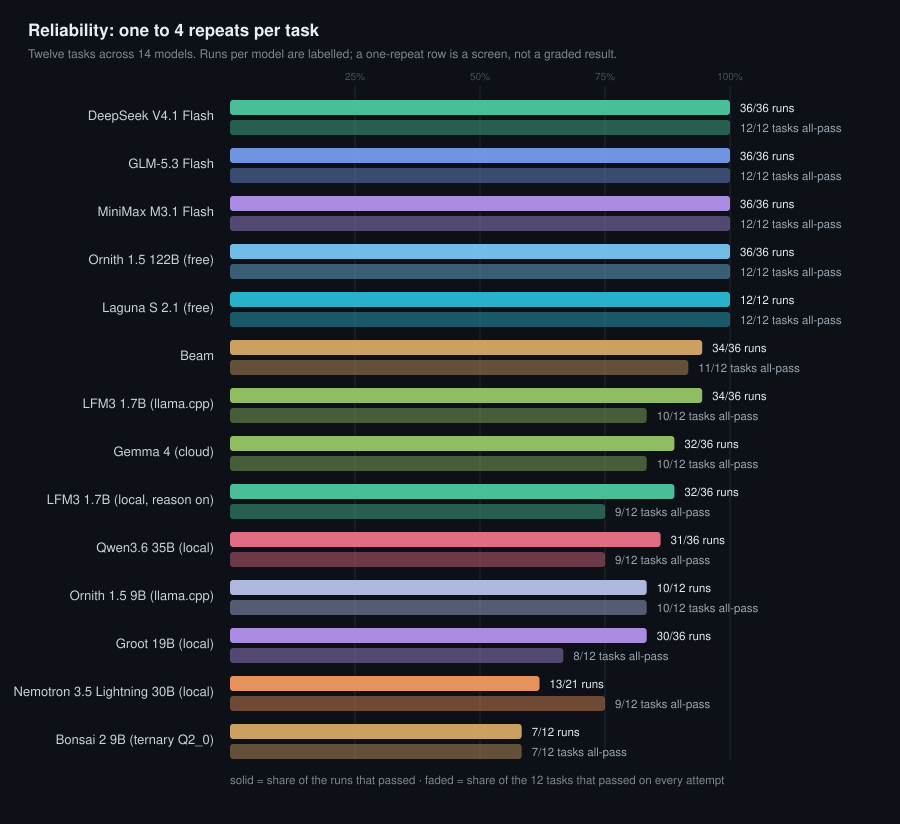
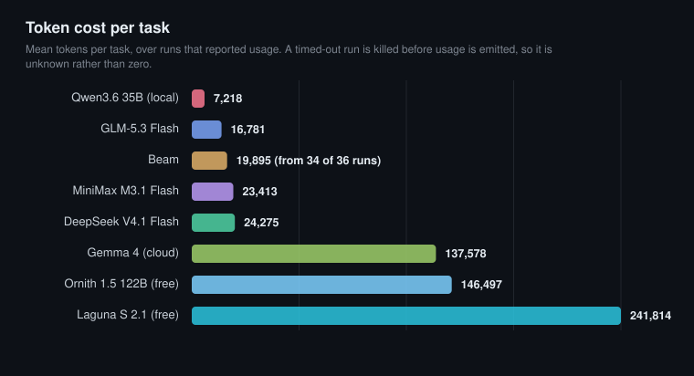
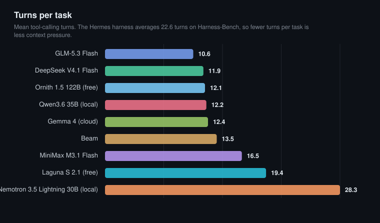
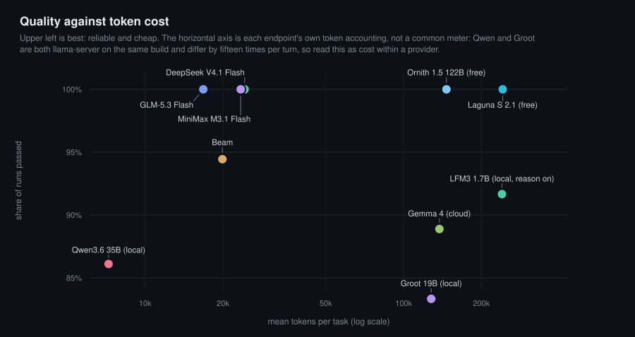
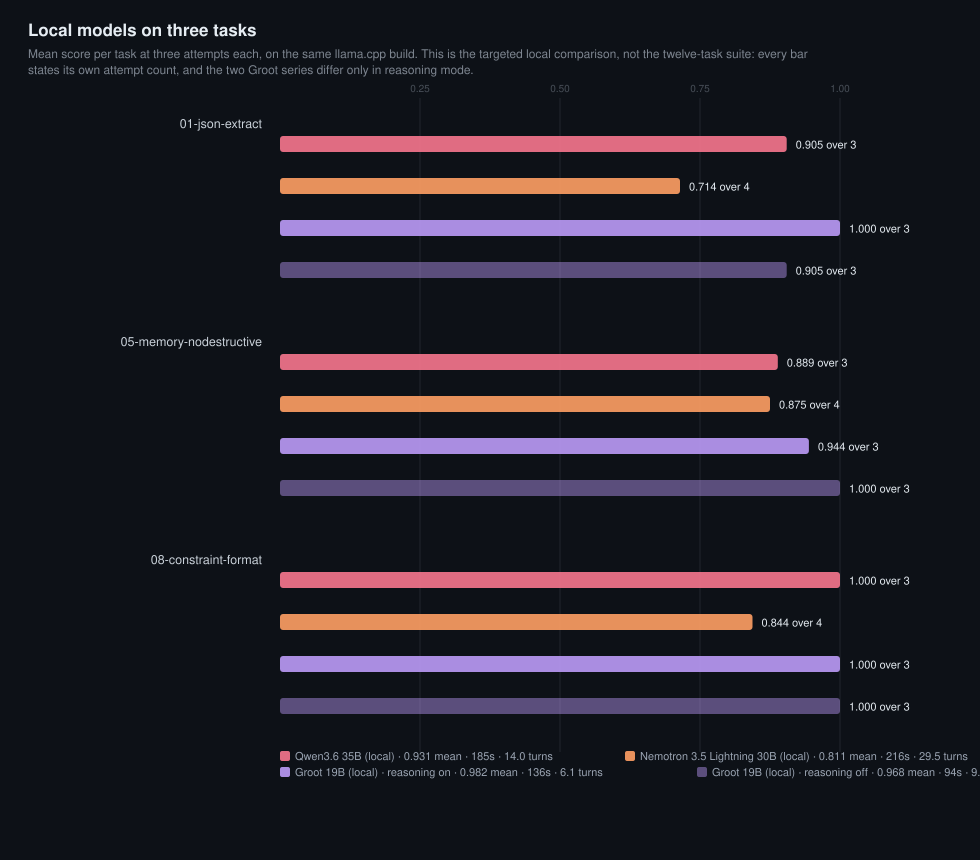

# hbench

A small, reproducible benchmark for choosing a **default model for the Hermes Agent harness**.

It answers one question: which model actually finishes the work, judged on the files and state it leaves behind rather than on the reply it writes.

---

## Why this exists

Running ad-hoc prompts through an agent and comparing the transcripts gives unstable results. Three things cause the drift:

1. **The reply is not the work.** Models describe success without committing it. Harness-Bench (arXiv [2605.27922](https://arxiv.org/abs/2605.27922)) measured this artifact-commitment failure at 11.1% of all agent failures.
2. **State carries between runs.** An agent that writes memory or notes during one run changes the starting conditions of the next.
3. **Turn count is not constant across models.** Harness-Bench Table 2 found the Hermes harness averages **22.6 turns and 139.7K tokens per task**, against 5.0 to 12.1 turns for other harnesses on identical work. A model that looks competent in a six-turn prompt can fall apart at turn fifteen.

This harness addresses all three.

## What it measures

Twelve tasks, each graded by asserting over the resulting file tree.

| Task | Failure class | What a model must do |
|---|---|---|
| `01-json-extract` | Contract / format | Emit schema-valid JSON with correct arithmetic over a CSV |
| `02-inventory-reconcile` | Evidence / grounding | Reconcile two sources without inventing records |
| `03-test-fix` | Tool / recovery | Run a suite, read the failure, fix the implementation not the test |
| `04-rename-safe` | Artifact commitment | Actually perform renames; describing them fails |
| `05-memory-nodestructive` | Safety / restraint | Answer a question without mutating inputs |
| `06-multiturn-continuity` | State / continuation | Carry three dependent stages forward |
| `07-error-recovery` | Tool / recovery | Diagnose a failed pipeline and satisfy what it actually wants |
| `08-constraint-format` | Instruction following | Satisfy six simultaneous formatting constraints |
| `09-long-context-retrieval` | Long context | Find three codes buried at 12%, 48% and 91% of an 82 KB log |
| `10-multifile-refactor` | Code change | Fix a rounding bug across files without touching the tests |
| `11-correction-handling` | Instruction persistence | Honour a mid-prompt reversal of an earlier instruction |
| `12-long-chain` | Long horizon | 14 dependent steps over 12 files with shuffled column order |

Four of these are adapted from the roadmap in Bent-Solutions/hermes-bench section 15 (instruction following, tool-call error recovery, long-context retrieval, multi-file code change). Two are additions aimed at the long-horizon failure the 22.6-turn figure implies.

## Credits

This project stands on published work. See [CREDITS.md](CREDITS.md) for the full account of what came from where.

- **Harness-Bench** (Yao et al., Peking University, arXiv [2605.27922](https://arxiv.org/abs/2605.27922), code at [Qihoo360/harness-bench](https://github.com/Qihoo360/harness-bench)) supplies the failure taxonomy and every percentage quoted above. No tasks or graders were taken from it.
- **Bent-Solutions/hermes-bench** (MIT) supplies the idea for four tasks, from the category list in its section 15 roadmap. No code or content was taken; their grading model is string matching, this one asserts over the file tree.
- **Nous Research, Hermes Agent** (MIT) is the harness being measured. The CLI flags this runner depends on are theirs.
- **Qwen3.6 35B A3B** (Apache 2.0, Alibaba/Qwen) is the local model in the baseline. The GGUF build is [unsloth/Qwen3.6-35B-A3B-GGUF](https://huggingface.co/unsloth/Qwen3.6-35B-A3B-GGUF), quantised with Unsloth Dynamic 2.0.
- **verkyyi/hermesbench** (MIT) was consulted for comparison and shaped the decision about what this project should not try to be.

## Design decisions worth knowing

**Grading inspects state, never prose.** Each `judge.py` receives the working directory after the agent exits and returns pass/fail per check. Nothing is scored by reading the model's answer.

**A fault is recorded beside the score, not instead of it.** The workspace is graded first. A run that ended non-zero after producing its artifact keeps that artifact score, with the exit code and the fault class shown next to it in the **Faults** column: a model that hits the agent's own turn ceiling after writing a correct file is a finding about the model, and scoring it 0.00 reports the harness ceiling as the model's capability. A run with no artifact of its own is not scored at all (a provider substitution, a refused argv, an untouched workspace): it is filed under `results/excluded/` with its reason, and the publisher refuses the whole run when the cause is a stall rather than a ceiling. The earlier rule (any non-zero exit scores zero) hid four graded task-08 attempts as 0.00, two of which had run the requested model and two of which had been answered by a fallback model.

**Tasks are verified in both directions.** `tests/test_graders.py` asserts every grader scores 0 on an empty workspace and 1.00 on a reference solution. It has caught four real defects: checks that passed on a wiped directory, an arithmetic error in an expected value, a test suite that passed before any fix, and a hash comparison against a stale literal.

**The published surfaces are checked against each other.** `tests/test_publish.py` asserts that every model in `results/` is named in every chart and in the results table, and it fails if a chart drops one. It exists because Ornith 1.5 122B published at 36/36 and appeared in none of the four charts: the table builder fell back to the raw model id while the chart builder filtered against its own hardcoded list. Nothing errored. A model that is published in one place and missing from another is worse than one that is missing from both.

**Memory and user config injection are disabled** (`--ignore-rules --ignore-user-config`), so runs are comparable and personal memory does not leak into results.

**Sessions are tagged and archived.** Runs use `--source tool`, which keeps them out of
the user's session lists, and the run's session rows are archived (`archived=1`) after
grading. Deletion is refused by the session store's runtime ledger, so archiving is the
operation that actually runs.

**A hard ceiling per task.** `--max-turns` bounds the turns, and the runner's own
subprocess timeout bounds the wall clock; exceeding either records a failure with exit
code `-1`. The `--run-budget` flag was removed from the child command when `hermes chat`
became a gateway client, so every record now carries `budget_mode: runner_timeout`.

**No live network.** Task prompts state that all needed data is in the working directory, so a page changing cannot move a score.

## Install

Requires Python 3.10 or newer, a working `hermes` CLI on `PATH`, and `pytest` for task 03.

```bash
git clone https://github.com/raidbeforebed/hermes-harness-bench.git
cd hermes-harness-bench

python3 -m venv .venv
.venv/bin/pip install pytest
```

The runner is standard library only; no third-party packages are needed for it.

## Use

```bash
# list the tasks
.venv/bin/python bin/hbench.py list

# verify the graders before trusting any result
.venv/bin/python tests/test_graders.py

# verify that every published result reached every chart and the README table
python3 tests/test_publish.py

# run one model over the full suite
.venv/bin/python bin/hbench.py run \
    --model deepseek-v4.1-flash:1017 --provider ollama-cloud --tasks all

# compare several models, three repeats for variance
.venv/bin/python bin/hbench.py run \
    --model <model-a> --model <model-b> \
    --provider <provider> --tasks all --repeat 3

# read a finished run
.venv/bin/python bin/hbench.py report <run_id>
.venv/bin/python bin/hbench.py matrix <run_id>
```

Results land in `runs/<run_id>/`, one directory per model per task, each with a `result.json`.

### Testing local models

`llama-server` works directly; confirm `n_ctx` is large enough and that the server
emits native tool calls. `Ollama` on a card under 24 GiB serves only 4096 tokens
by default, which is smaller than an agent system prompt, so every task fails
before the model does any work. Both cases, and how to read local results
honestly, are covered in [docs/local-models.md](docs/local-models.md).

```bash
# llama.cpp
python bin/hbench.py run --model <alias> --provider qwen-local --tasks all
```
## Results as published

Every model below was run on the same twelve tasks with the same graders. Raw
per-task records are in `results/`, one file per task per repeat. This table is
generated from `results/` by `tools/publish.py`, so it cannot drift from the data.

<!-- RESULTS:START -->
| Model | Repeats | Runs passed | Faults | Tasks all-pass | Mean turns | Mean tokens | Mean wall | Total |
|---|---|---|---|---|---|---|---|---|
| DeepSeek V4.1 Flash | 3 | **36/36 (100%)** | - | 12/12 | 11.9 | 24,275 | 34 s | 21 min |
| GLM-5.3 Flash | 3 | **36/36 (100%)** | - | 12/12 | **10.6** | 16,781 | 56 s | 34 min |
| MiniMax M3.1 Flash | 3 | **36/36 (100%)** | - | 12/12 | 16.5 | 23,413 | 82 s | 49 min |
| Ornith 1.5 122B (free) | 3 | **36/36 (100%)** | - | 12/12 | 12.1 | 146,497 | 115 s | 69 min |
| Laguna S 2.1 (free) | 1 | **12/12 (100%)** | - | 12/12 | 19.4 | 241,814 | 162 s | 32 min |
| Beam | 3 | 34/36 (94.4%) | - | 11/12 | 13.5 | 19,895 | 64 s | 39 min |
| Gemma 4 (cloud) | 3 | 32/36 (88.9%) | - | 10/12 | 12.4 | 137,578 | **18 s** | 11 min |
| Qwen3.6 35B (local) | 3 | 31/36 (86.1%) | - | 9/12 | 12.2 | **7,218** | 107 s | 64 min |
| Nemotron 3.5 Lightning 30B (local) | 1-4 | 13/21 (61.9%) | agent_exit 2, turn_limit 2 | 9/12 | 28.3 | 397,830 | 195 s | 68 min |
| LFM3 1.7B (local, reason on) | 3 | 32/36 (88.9%) | agent_exit 1, turn_limit 1 | 9/12 | 24.4 | 333,947 | 245 s | 2.45 h |
| LFM3 1.7B (llama.cpp) | 3 | 34/36 (94.4%) | - | 10/12 | 23.0 | 327,400 | 140 s | 84 min |
| Ornith 1.5 9B (llama.cpp) | 1 | 10/12 (83.3%) | - | 10/12 | 16.1 | 201,698 | 210 s | 42 min |
| Bonsai 2 9B (ternary Q2_0) | 1 | 7/12 (58.3%) | - | 7/12 | 14.2 | 162,254 | 90 s | 18 min |
| Groot 19B (local) | 3 | 30/36 (83.3%) | - | 8/12 | 11.9 | 127,891 | 71 s | 42 min |
<!-- RESULTS:END -->

Read the **Repeats** column before comparing rows. A one-repeat row is a screening
measurement, not a stable figure: the same model scored 0.80 and then 1.00 across two
single-repeat runs of different timeout, which is why the graded baseline is three
repeats. Charts and this table are generated from `results/` by `tools/publish.py`, so
they cannot drift from the data.

Two columns, because they answer different questions:

- **Runs passed** counts every execution the model attempted, 36 for a three-repeat row
  and 12 for a screening row. It is not `pass@1` in the usual sense, which would be a
  single first-attempt probability; this repository does not report that, because one
  attempt per task is exactly what proved unreliable here.
- **Tasks all-pass** counts how many of the twelve tasks succeeded on every attempt. That
  is the stability figure. A model can show a high runs-passed number while still
  having a task it fails two-thirds of the time; the Beam row is that case.
- **Faults** counts rows that ended non-zero, or on a different model than the one asked
  for. A row that did the work and then hit the agent's own turn or wall ceiling keeps its
  artifact score, and the exit code travels with the row rather than replacing it. A row
  answered by a fallback model is not scored at all: it is filed under
  [`results/excluded/`](results/excluded/) with its class, its exit code and the run it
  came from. Two of Nemotron's 23 attempts were answered by a fallback model and are
  excluded that way, which is why its Repeats column reads 1-4 over 21 scored rows rather
  than 23.

### At a glance



The solid bar is the share of the runs each model attempted. The faded bar is the share
of the twelve tasks that passed on **every** attempt. Both are drawn as a proportion of
their own denominator and both carry their counts, so a one-repeat screening row cannot
be read as a graded one. A gap between the two bars is the useful signal: Beam passes 34
of 36 runs yet has a task it fails two-thirds of the time, Qwen's gap is wider, and
Nemotron's is wider again at 13 of 21 runs with nine of twelve tasks stable.







The Qwen row sits far left on token cost, but that axis needs a warning before anyone reads a
ranking off it. The figure is whatever each endpoint reported, and two `llama-server` models on
the same build disagree by more than an order of magnitude per turn: Qwen reports 711 prompt
tokens a turn, Groot 10,710, on the same tasks and the same harness. That is an accounting
difference, not a model difference, so **compare tokens within one endpoint, never across
providers**, and treat the cost chart as a description of what was counted rather than of what was
spent.

On reliability Qwen is at 86.1 per cent of the twelve-task suite against the paid models' 100.
Groot now has a suite row of its own, and both local models also appear on the targeted chart
further down, which is where their comparison is actually fair.

Ornith sits well to the right of the three paid models it ties with. It reaches 36/36 on
146,497 tokens a task, six times DeepSeek's, and at 115 seconds mean it is the second
slowest row in the table after Laguna S. What the chart cannot show is price: Ornith was
free on the Nous Portal on the day it ran, so the tokens buy no dollars, only latency.

These four charts cover `results/`, the balanced twelve-task suite. The local models were also
measured on the three tasks they fail, which is a different design and gets its own chart further
down: [local-three-task.svg](assets/local-three-task.svg), from `tools/make_local_chart.py`. Nothing
from that targeted run appears in the four above, on purpose: nine attempts on three hard tasks drawn
beside thirty-six attempts on twelve would look like a comparison of models when it is a comparison of
task mixes.

Charts are generated from `results/` by `tools/make_charts.py`, so they cannot drift
from the data. Re-run it after a benchmark:

```bash
python3 tools/make_charts.py
```

### Five of 14 rows are perfect, so cost is the only differentiator

Four models passed all **36 of 36** runs with zero variance on every individual task and
zero timeouts, and a fifth, Laguna S 2.1, passed all 12 runs of its single-repeat
screening pass. When five of the 14 rows are perfect, pass rate tells you almost
nothing and the useful question becomes what each one costs to be perfect:

- **DeepSeek V4.1 Flash is the fastest of the five perfect rows**, at 34 seconds mean
  and 21 minutes for the full suite. It is also the most token-hungry of the three paid
  ones at 24,275, roughly 45 percent more than GLM. Fast here means it takes more,
  shorter turns rather than fewer efficient ones.
- **GLM-5.3 Flash is the most efficient**, at 10.6 turns and 16,781 tokens, a third
  fewer tokens than DeepSeek and 28 percent fewer than MiniMax. It is 65 percent
  slower in wall time, which on a cloud model costs little and on this suite does not
  matter.
- **MiniMax M3.1 Flash is perfect but expensive on both axes**: most turns, nearly
  the most tokens, and the slowest paid model at 82 seconds mean. Its
  `07-error-recovery` runs averaged 370 seconds against 35 to 124 for everything else.
- **Ornith 1.5 122B costs no money and the most tokens**: free on the Nous Portal,
  perfect on all 36 runs, and 146,497 tokens a task, six times DeepSeek's and more than
  any other model graded three times. Its 115 second mean is the price of that spend, not
  of the model being weak.

**For the local default the answer stays Qwen3.6-35B-A3B.** Groot is faster and ties on
pass count within one attempt, and it is the better model on `05` and `07`; but it fails
`01-json-extract` on all three attempts where Qwen fails it once, and `01` is the plainest
task in the set, a schema-valid JSON with arithmetic over a CSV. A model that cannot be
trusted with that is not the one to leave installed as the fallback. Groot's weights were
removed from the workstation after the comparison; its measurements stay here, because a
result that disappears when a model loses is not a measurement.

If the question is which model to make the default, GLM-5.3 Flash is the answer on a
paid account: it ties on quality, uses the fewest tokens, and takes the fewest turns.
DeepSeek wins only if wall-clock latency matters more than token spend, and Ornith wins
only while it stays free and the queue does not.

### Ornith 1.5 122B: free, perfect, and the most token-hungry row that does it

36 of 36 runs, twelve of twelve tasks stable, zero failed checks out of 216, at 12.1 turns
and 115 seconds mean. On this suite a 122B model served free through the Nous Portal
matched the three paid models exactly. Laguna S was free and perfect too, but on a single
pass, so Ornith is the first free row here to hold up across three repeats.

It is also the least efficient way to be perfect. 146,497 tokens a task is six times
DeepSeek and 8.7 times GLM, and most of it goes on one task: `07-error-recovery` averages
**414 seconds and 408,608 tokens** across its three runs. Every model finds that task the
expensive one, and Ornith pays it in the currency it has, which is tokens rather than
dollars. Its `06-multiturn-continuity` and `01-json-extract` runs also sit above 140,000
tokens, against 64,000 for `11-correction-handling`, so the spread is task-driven rather
than a fixed per-call overhead.

**One correction is recorded in the history.** Nine of the 36 runs overlapped a runaway
local MusicGen process holding the machine at load 8.2, and recorded inflated wall, turn
and token figures. Those three tasks were re-run on a clean machine and the nine records
replaced: mean wall 130.7 to 115.3 seconds, turns 13.3 to 12.1, tokens 5.95M to 5.27M.
Scores did not move, and every judge was re-executed against the saved work directories
to confirm the pass logic had not. The result files in `results/` are the corrected ones,
which is why this row differs from any figure quoted before that re-run.

What that buys: if a free tier is acceptable, Ornith ties the paid models on reliability
and costs nothing but latency. It is not a default for interactive work at 115 seconds a
task, and a free pool can be withdrawn or rate-limited without notice, which the score
cannot warn you about.

### Beam is 94.4%, not 100%

Eleven tasks passed three times out of three. The single failure is
`07-error-recovery`, and it is a budget story rather than a wrong answer:

| Repeat | Result | What happened |
|---|---|---|
| r1 | 0.00 | hit the 540 s budget after 58 turns |
| r2 | 0.00 | hit the 540 s budget after 18 turns, slow individual calls |
| r3 | 1.00 | finished cleanly in 167 s, 35 turns |

Beam thrashes on this task and sometimes does not converge. Its earlier single run
scored 12/12, which was luck.

### MiniMax M3.1 Flash: 36/36, and why the earlier 10/12 was wrong

Zero variance on every task, zero timeouts. That overturns the first published result
of 10/12, and the correction matters more than the number.

The earlier failures were **timeouts on a run with a misconfigured harness**, not
model limits. With three clean repeats it never missed. Published once, that model
would have been written off as unreliable on long-horizon work. It is instead one of
the five perfect rows.

It is also the slowest paid row, and the most expensive in turns. It spends **370
seconds on average on `07-error-recovery`** while every other task costs 35 to 124
seconds. Reliable, not fast.

### Gemma 4: the fastest model, and one ambiguous field it reads the same way every time

32 of 36 runs, ten of twelve tasks stable, 0.982 mean score. It is the fastest model
measured on this suite: **18 seconds mean and 11 minutes for the whole thing**, half of
DeepSeek and a sixth of the local Qwen. Turns are unremarkable at 12.4, so the speed is
per-call latency, not fewer steps.

The token column is the outlier and needs reading carefully. It reports **137,578 mean,
5.7 times DeepSeek**, which looks like a cost disaster and is not necessarily one: the
figure is the harness's reported usage and it includes context re-sent on every turn. The
session ledger shows a mean of 118,835 cached-input tokens per session against 12,659 fresh,
so the number measures **context processed, not billed cost**. Whether that is expensive
depends on the provider's cache pricing, which this suite does not model. Do not read the
token column as a price column for this row.

Both imperfect tasks are shown below, and only one of them is variance:

| Task | Result | What happened |
|---|---|---|
| `05-memory-nodestructive` | 0.83 in all three repeats | answered `entry_count: 2` instead of 3, in every repeat |
| `06-multiturn-continuity` | 0.86 in r1 only | one averaged duration off by 2 ms (97.4 vs 99.4), r2 and r3 clean |

`05` is the interesting one: identical answer three times, so it is comprehension rather
than luck. The task asks for `alice_total`, `entry_count` and `owners` from a three-entry
file. Gemma returned the correct `alice_total` of 40 and the correct `owners` of
`["alice","bob"]`, which proves it read all three entries, then reported `entry_count` as
**2**, the count for the queried owner rather than the count of entries in the file. The
field name is genuinely ambiguous; the grader is not, and the six models that pass this
check all read it as 3.

Qwen fails the same check with the same answer: `entry_count: 2`, in all three of its
repeats. Two different architectures, the same reading of an ambiguous field, which says
more about the prompt than about either model. The two rows are only distinguishable at
all by reading the check detail, which is why the field is worth naming rather than
counting.

That is the reason to prefer the two-column reporting over a single pass rate. A bare
88.9% would not tell you the model is fast, correct on everything else, and reliably wrong
in the same way on one specific ambiguity, which is a prompt-design problem it would hit
every time rather than a reliability problem that averaging hides.

### Qwen3.6 35B A3B: 86.1% on a 2017 GPU

Full hardware, launch flags and throughput: [reference-hardware.md](docs/reference-hardware.md).
Model: [Qwen/Qwen3.6-35B-A3B](https://huggingface.co/Qwen/Qwen3.6-35B-A3B), GGUF from
[unsloth](https://huggingface.co/unsloth/Qwen3.6-35B-A3B-GGUF), `UD-Q4_K_M`, served by
`llama-server` with `--n-cpu-moe` on an 8 GB card at 18.6 tokens/second.

| Task | r1 | r2 | r3 | Reading |
|---|---|---|---|---|
| `01-json-extract` | 0.71 | 1.00 | 1.00 | **flaky**: three runs gave 120.47, 125.48, and a correct 149.97 |
| `07-error-recovery` | 0.00 | 1.00 | 1.00 | **flaky**: once wrote the output without fixing the input the pipeline validates |
| `05-memory-nodestructive` | 0.83 | 0.83 | 0.83 | **deterministic**: `entry_count: 2` for a three-entry file, every time |
| the other nine | 1.00 | 1.00 | 1.00 | stable, zero variance |

Nine of twelve passed every time. The two kinds of failure are worth separating:

**Task 05 is a systematic counting error.** It computes `alice_total: 40` correctly
and then miscounts the rows, in all three runs. A 3B-active-parameter model is
dependable at reading and transforming data and unreliable at counting it, and no
amount of context or retrying changes that.

**Task 01 is arithmetic instability.** Same file, three different sums, correct about
one time in three, so any single run either overstates or understates it.

One local run took **70 turns and 464 seconds** and still passed. Under the default
budget it would have been killed and misreported as a failure. That is why
`--budget-scale` exists, and why turn limits are deliberately not scaled with it.

### Nemotron 3.5 Lightning 30B: two defects a single pass would have missed

Full hardware and launch flags: [reference-hardware.md](docs/reference-hardware.md).
Model: `NVIDIA-Nemotron-3.5-Lightning-30B-A3B-Q4_0`, served by `llama-server` build
`b11669` (v0.7.0) with the experts on the host and the card holding attention, on the
same 8 GB GPU.

| Task | attempts | Reading |
|---|---|---|
| `01-json-extract` | 0.57, 1.00, 0.57, 0.71 | **systematic**: counts all eight order rows instead of the seven shipped ones, so `total_orders` is 8 and revenue lands between 154.95 and 192.46 against 149.97 |
| `05-memory-nodestructive` | 0.83, 1.00, 0.67, 1.00 | **both kinds**: one run read `entry_count` as 2, another spent 63 messages and never wrote the answer file |
| `08-constraint-format` | 0.75, 0.88, 1.00, 0.75 | **does not stop**: it produced a file that satisfied all eight constraints once, and kept iterating in the others until the turn ceiling or the wall clock ended the run |
| the other nine | 1.00 each | stable on one attempt, zero variance |

Nine of twelve tasks are stable, 13 of 21 scored rows are perfect, mean 0.892. The two
findings are the point:

**It does not filter.** Every task-01 failure is the same mistake, not noise: it
aggregates the whole CSV, so the shipped-revenue figure it computes is wrong in three of
four attempts and right once. That is the shape of error that damages real work, and it
is only visible because the task has four attempts.

**It does not know when to stop.** One task-08 attempt met all eight constraints and was
still iterating when the runner killed it at 840 seconds; across four attempts it exited
cleanly once. Two attempts ended with an explicit iteration-limit message, two more with
exit code 1 and no message, and those four rows keep the artifact score they had earned.

Two of its 23 attempts were answered by a fallback model after the local endpoint
substituted (`gemma4:31b-cloud` and `deepseek-v4.1-flash:1017`), which the harness caught
by reading each child's own session row. Those attempts are excluded, not published as
zero, and the task they hit was re-run to four attempts on the requested model.

### Groot 19B: best on the hard three, behind Qwen on all twelve

Groot-19B-A3B-261023, released 2026-10-23 and post-trained from Qwen3.6-35B-A3B, was run on the full
suite at three repeats with reasoning off: **30 of 36 runs passed, eight of twelve tasks stable, mean
0.9595, 71 s mean wall, 11.9 turns, no faults, no timeouts.** It is the fastest and cheapest local
model here, and it is behind Qwen on reliability.

| | Groot 19B | Qwen3.6 35B |
|---|---|---|
| runs passed | 30/36 (83.3%) | **31/36 (86.1%)** |
| tasks stable | 8/12 | **9/12** |
| mean wall | **71 s** | 107 s |
| mean turns | **11.9** | 12.2 |

Where it loses:

- **`01-json-extract`, three times out of three, at 0.714.** The same filtering error Nemotron makes:
  the aggregate is taken over all eight CSV rows instead of the seven shipped ones. This is now a
  stable defect rather than an occasional one.
- **`12-long-chain` once at 0.667**, the only long-horizon stumble, recovered on the next two attempts.
- **`06-multiturn-continuity` and `08-constraint-format`** each lost one attempt to a partial file,
  0.857 and 0.875, both recovered.

**The honest part is the disagreement with the targeted run.** On the three hard tasks Groot scored
0.982 and looked like the strongest local model here; on the twelve-task suite it is below Qwen. The
cause is `01`: it passed two of three attempts in the targeted run and none of three in the suite,
same model, same build, same flags, same prompt. Three attempts is a small sample and the same task
can invert between runs, which is the whole argument for the twelve-task, three-repeat design and the
reason a targeted sample is never quoted as a suite score.

### Three local models on one instrument: Groot, Qwen, Nemotron



The numbers below are a three-task sample and not suite scores: Groot's twelve-task row is 83.3 per
cent, above in the table. All three were run on the same three tasks, three attempts each, on the same
`llama-server` build (`b11669`) and the same budget scale. Nemotron's figures include the two attempts re-run after the
endpoint substituted a fallback model; those two substitutions are excluded rather than scored.

| Task | Groot 19B | Qwen3.6 35B | Nemotron 3.5 Lightning 30B |
|---|---|---|---|
| `01-json-extract` | **1.000** over 3 | 0.905 over 3 | 0.714 over 4 |
| `05-memory-nodestructive` | **0.944** over 3 | 0.889 over 3 | 0.875 over 4 |
| `08-constraint-format` | **1.000** over 3 | **1.000** over 3 | 0.844 over 4 |
| mean of task means | **0.982** | 0.931 | 0.811 |
| attempts perfect | **8 of 9** | 6 of 9 | 4 of 12 |
| mean wall per attempt | **136 s** | 185 s | 216 s |
| mean turns | **6.1** | 14.0 | 29.5 |

Groot leads on every axis measured here: score, wall clock, turns, and electricity. It is also the
smallest of the three at 19B total against 30B and 35B, which is the interesting part of the result
rather than a footnote.

- **`01` separates them cleanly.** Groot aggregated the shipped orders correctly in three attempts
  out of three. Qwen missed once in three, the arithmetic instability its own published row records.
  Nemotron made the same filtering error three times in four, so its 0.714 is a stable defect.
- **`05` is nearly a draw and is a prompt problem.** All three read `entry_count` as 2 for a
  three-entry file at least once. Groot's single missed attempt is exactly that check.
- **`08` is where Nemotron falls out of the running.** Groot and Qwen both satisfied all eight
  constraints three times out of three; Nemotron did it once in four, spending the rest at the turn
  ceiling with a partial file.

**One configuration difference, stated in the artifact rather than in prose.** Groot ran in its
default thinking mode; the other two had thinking disabled by their launch flags. The run carries
that as `notes: {reasoning: on, reasoning_source: ..., llama_build: b11669-620d2225c, server_flags:
...}` in its manifest and on every record, so the figure cannot be lifted out of context later. Its
6.1 mean turns against 14.0 and 29.5 say the thinking did not become long deliberation here, and a
`--reasoning off` run on the same nine attempts is the like-for-like check.

This comparison is kept as its own artifact,
[`results/head-to-head/local-three-way-20261027.json`](results/head-to-head/local-three-way-20261027.json)
(run ids: `groot-weak3-reasoning-on-20261027`, `qwen-weak3-20261027`, `nemotron-recorded`),
rather than merged into the tables above. A published row is a balanced design, every task attempted
the same number of times; these nine extra attempts deliberately target the three tasks each model
failed, so folding them into a published row would move a twelve-task headline into describing a
different design. `tools/head_to_head.py` produces it from the run directories.

### Reasoning on against reasoning off, same nine attempts

Groot runs in thinking mode by default. The same nine attempts were run again with
`--reasoning off`, on the same build and the same model file, so the mode is the only variable.

| | reasoning on | reasoning off |
|---|---|---|
| `01-json-extract` | **1.000** over 3 | 0.905 over 3 |
| `05-memory-nodestructive` | 0.944 over 3 | **1.000** over 3 |
| `08-constraint-format` | **1.000** over 3 | **1.000** over 3 |
| mean of task means | **0.982** | 0.968 |
| attempts perfect | 8 of 9 | 8 of 9 |
| mean wall per attempt | 136 s | **94 s** |
| mean turns | **6.1** | 9.5 |
| mean tokens per attempt | **69,533** | 103,255 |

**Quality is a wash on this sample.** Each arm lost one attempt, on different tasks: thinking mode
missed the `entry_count` check once, non-thinking mode mis-summed the shipped revenue once. Both are
failures the other local models also make. Three tasks and nine attempts per arm cannot separate
0.982 from 0.968, and the honest reading is that they are the same.

**The two costs move in opposite directions, and that is the finding.** Thinking mode took 44.7 percent
longer in wall clock (136 s against 94 s) yet needed 35.8 percent fewer turns (6.1 against 9.5) and
32.7 percent fewer tokens (69,533 against 103,255). Non-thinking mode is
faster per attempt because every turn is cheap, but it needs more turns to finish, and each extra turn
re-sends the conversation, which is where its larger token count comes from.

On this hardware a thinking token is expensive: with every expert on the host, decode is bound by
system RAM and runs at tens of tokens per second, so deliberation is paid in seconds. What it buys
here is not a better answer but a more decisive one, fewer tool calls per task. Which trade is worth
taking depends on whether wall clock or the token bill matters more, and on this box the wall clock is
the scarcer resource.

Both runs carry their mode as a note on every record, so the artifact behind this table cannot be read
without it: [`results/head-to-head/groot-reasoning-pair-20261027.json`](results/head-to-head/groot-reasoning-pair-20261027.json),
from runs `groot-weak3-reasoning-on-20261027` and `groot-weak3-reasoning-off-20261027`.

### What three repeats actually bought

- **A model was nearly written off wrongly.** MiniMax's 10/12 became 36/36.
- **A lucky run was exposed.** Beam's 12/12 became 94.4%.
- **Two failure types were separated.** On the local model, task 05 looked like a
  one-off and turned out deterministic; task 01 looked deterministic and turned out
  flaky. One run cannot tell those apart.
- **A budget artefact was caught.** Beam's failures are timeouts, not wrong answers,
  which points at a different remedy.
- **A machine fault was caught, not published as a model result.** Nine Ornith runs
  overlapped a runaway local process. Re-running them on a clean machine moved the wall,
  turn and token figures and left the scores at 1.00, which is what tells you a slow box
  apart from a weak model. That correction is in the history, not quietly absorbed.

- **The top of the table survived, the middle did not.** GLM and DeepSeek both came
  out at 36/36, so their single-run 12/12 was real. MiniMax and Beam both moved. The
  models you would have ranked by a single run are the ones most likely to have been
  ranked wrongly, and you cannot predict which from the score.

The asymmetry is the argument: a flaky model scored once looks either better or
worse than it is, and the number alone never says which. Three repeats cost roughly
an hour per model and settled it.

## Limits

- Twelve tasks is a **screen, not a leaderboard**. It separates reliable from
  unreliable well; it does not finely rank models that are all reliable.
- **Free tiers move.** Laguna S 2.1 and Ornith 1.5 122B were free on the Nous Portal on
  the dates recorded in their result files. A free row can be withdrawn, rate-limited or
  re-priced without any of its numbers changing, so read the price from the provider, not
  from this table.
- The suite discriminates on **reliability under long-horizon work**, not on
  capability ceiling. Several tasks are clean for every model tested.
- **The local comparison is a targeted sample, not a suite score.** Three tasks, nine attempts per
  model, chosen because they are where local models fail. That is enough to separate Groot from
  Nemotron and to compare two configurations of one model, and not enough to place any of them on the
  twelve-task table. Local models therefore appear in `results/` only where a full suite was actually
  run, and their targeted work lives in [`results/head-to-head/`](results/head-to-head/).
- **A timeout is a failure, not a verdict on quality.** Every Beam failure was a
  budget exhaustion on a task where it thrashes, not a wrong answer. On slower
  hardware, or with a different budget, that number moves. The budget is recorded in
  every run manifest for this reason.
- Provider-specific settings (reasoning effort, thinking defaults, temperature) are
  not normalized. Pin them per model if a comparison must be exact.
- Concurrent runs share one Hermes install. Relocating `HERMES_HOME` per run was tried
  and abandoned: a cold home triggers Hermes' dependency bootstrap, which re-execs and
  loses its command line under contention.

## Adding a task

Create `tasks/<your-task>/` with:

```
task.json      {"max_turns": 40, "run_budget": 420, "timeout": 480}
prompt.md      the instruction the agent receives
workspace/     the starting files, copied fresh for every run
judge.py       argv[1] is the working directory; print {"checks": [...]}
```

`judge.py` must print exactly:

```json
{"checks": [{"check": "name", "pass": true, "detail": "why"}]}
```

Then add a solver to `tests/test_graders.py` and confirm it reports 0 on an empty workspace and 1.00 on your reference solution. A task whose grader cannot be verified in both directions is not a task.

## Licence

MIT.
